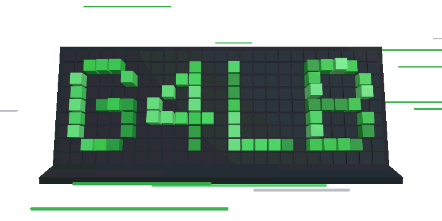

I build things in Go, Python & TypeScript.  
I also contribute to the open-source projects behind them.

##  Go

-  **[prometheus/prometheus](https://github.com/prometheus/prometheus)** — Monitoring system (⭐ **67.6k**)
-  **[gofiber/fiber](https://github.com/gofiber/fiber)** — Web framework (⭐ **40.3k**)
-  **[valyala/fasthttp](https://github.com/valyala/fasthttp)** — High-performance HTTP (⭐ **23.5k**)
-  **[redis/go-redis](https://github.com/redis/go-redis)** — Redis client (⭐ **22.3k**)

More Go contributions (23)

-  **[lionsoul2014/ip2region](https://github.com/lionsoul2014/ip2region)** — IP to region lookup (⭐ **20k**)
-  **[pion/webrtc](https://github.com/pion/webrtc)** — WebRTC in pure Go (⭐ **16.9k**)
-  **[go-sql-driver/mysql](https://github.com/go-sql-driver/mysql)** — MySQL driver (⭐ **15.3k**)
-  **[gogf/gf](https://github.com/gogf/gf)** — Application framework (⭐ **13.3k**)
-  **[esimov/caire](https://github.com/esimov/caire)** — Content-aware image resize (⭐ **10.9k**)
-  **[wader/fq](https://github.com/wader/fq)** — Binary format tool (⭐ **10.6k**)
-  **[johnkerl/miller](https://github.com/johnkerl/miller)** — CSV & JSON tool (⭐ **10.1k**)
-  **[go-co-op/gocron](https://github.com/go-co-op/gocron)** — Job scheduler (⭐ **7.2k**)
-  **[prometheus/client_golang](https://github.com/prometheus/client_golang)** — Prometheus client (⭐ **6k**)
-  **[klauspost/compress](https://github.com/klauspost/compress)** — Compression library (⭐ **5.7k**)
-  **[brianvoe/gofakeit](https://github.com/brianvoe/gofakeit)** — Fake data generator (⭐ **5.4k**)
-  **[duke-git/lancet](https://github.com/duke-git/lancet)** — Utility library (⭐ **5.3k**)
-  **[dromara/carbon](https://github.com/dromara/carbon)** — Time package (⭐ **5.2k**)
-  **[alecthomas/chroma](https://github.com/alecthomas/chroma)** — Syntax highlighting (⭐ **5.1k**)
-  **[uptrace/bun](https://github.com/uptrace/bun)** — SQL-first ORM (⭐ **5k**)
-  **[olekukonko/tablewriter](https://github.com/olekukonko/tablewriter)** — ASCII table writer (⭐ **4.8k**)
-  **[itchyny/gojq](https://github.com/itchyny/gojq)** — jq in pure Go (⭐ **3.8k**)
-  **[twmb/franz-go](https://github.com/twmb/franz-go)** — Kafka client (⭐ **3.2k**)
-  **[redis/rueidis](https://github.com/redis/rueidis)** — Redis client (⭐ **3k**)
-  **[gocarina/gocsv](https://github.com/gocarina/gocsv)** — CSV marshaling (⭐ **2.2k**)
-  **[gomarkdown/markdown](https://github.com/gomarkdown/markdown)** — Markdown parser (⭐ **1.7k**)
-  **[dlclark/regexp2](https://github.com/dlclark/regexp2)** — Regex engine (⭐ **1.2k**)
-  **[andybalholm/cascadia](https://github.com/andybalholm/cascadia)** — CSS selector library (⭐ **760**)

##  Python

-  **[pypa/packaging](https://github.com/pypa/packaging)** — Packaging utilities (⭐ **757** ·  **439.8M** downloads/week)
-  **[eliben/pycparser](https://github.com/eliben/pycparser)** — C parser (⭐ **3.6k** ·  **286.2M** downloads/week)
-  **[fsspec/filesystem_spec](https://github.com/fsspec/filesystem_spec)** — Filesystem interface (⭐ **1.4k** ·  **141.7M** downloads/week)
-  **[aio-libs/aiohappyeyeballs](https://github.com/aio-libs/aiohappyeyeballs)** — Happy Eyeballs algorithm (⭐ **47** ·  **121M** downloads/week)

More Python contributions (14)

-  **[facelessuser/soupsieve](https://github.com/facelessuser/soupsieve)** — CSS selector library (⭐ **272** ·  **79.6M** downloads/week)
-  **[rthalley/dnspython](https://github.com/rthalley/dnspython)** — DNS toolkit (⭐ **2.7k** ·  **72.2M** downloads/week)
-  **[redis/redis-py](https://github.com/redis/redis-py)** — Redis client (⭐ **13.7k** ·  **58.1M** downloads/week)
-  **[gitpython-developers/GitPython](https://github.com/gitpython-developers/GitPython)** — Git library (⭐ **5.2k** ·  **34.7M** downloads/week)
-  **[horejsek/python-fastjsonschema](https://github.com/horejsek/python-fastjsonschema)** — JSON Schema validator (⭐ **502** ·  **29.2M** downloads/week)
-  **[psf/black](https://github.com/psf/black)** — Code formatter (⭐ **42.2k** ·  **25.8M** downloads/week)
-  **[nhairs/python-json-logger](https://github.com/nhairs/python-json-logger)** — JSON log formatter (⭐ **280** ·  **25.4M** downloads/week)
-  **[PyCQA/isort](https://github.com/PyCQA/isort)** — Import sorter (⭐ **7k** ·  **22.3M** downloads/week)
-  **[tobymao/sqlglot](https://github.com/tobymao/sqlglot)** — SQL parser & transpiler (⭐ **9.8k** ·  **22M** downloads/week)
-  **[graphql-python/graphql-core](https://github.com/graphql-python/graphql-core)** — GraphQL implementation (⭐ **536** ·  **19.4M** downloads/week)
-  **[python-semver/python-semver](https://github.com/python-semver/python-semver)** — Semantic versioning (⭐ **526** ·  **18.4M** downloads/week)
-  **[piskvorky/smart_open](https://github.com/piskvorky/smart_open)** — Cloud file streaming (⭐ **3.5k** ·  **14.9M** downloads/week)
-  **[r1chardj0n3s/parse](https://github.com/r1chardj0n3s/parse)** — String parser (⭐ **1.8k** ·  **3.9M** downloads/week)
-  **[hgrecco/pint](https://github.com/hgrecco/pint)** — Physical units (⭐ **2.8k** ·  **2.2M** downloads/week)

##  TypeScript

-  **[pillarjs/path-to-regexp](https://github.com/pillarjs/path-to-regexp)** — Route path matcher (⭐ **8.6k** ·  **336.5M** downloads/week)
-  **[markedjs/marked](https://github.com/markedjs/marked)** — Markdown parser (⭐ **37.3k** ·  **129.5M** downloads/week)
-  **[BridgeAR/safe-stable-stringify](https://github.com/BridgeAR/safe-stable-stringify)** — Safe JSON.stringify (⭐ **254** ·  **99.1M** downloads/week)
-  **[toss/es-toolkit](https://github.com/toss/es-toolkit)** — Utility library (⭐ **11.4k** ·  **82.8M** downloads/week)

More TypeScript contributions (16)

-  **[pinojs/pino](https://github.com/pinojs/pino)** — JSON logger (⭐ **18.3k** ·  **81.9M** downloads/week)
-  **[planttheidea/fast-equals](https://github.com/planttheidea/fast-equals)** — Deep equality check (⭐ **615** ·  **70.3M** downloads/week)
-  **[react-hook-form/react-hook-form](https://github.com/react-hook-form/react-hook-form)** — Form library (⭐ **44.9k** ·  **68.6M** downloads/week)
-  **[planttheidea/fast-copy](https://github.com/planttheidea/fast-copy)** — Deep object copy (⭐ **1.2k** ·  **37.9M** downloads/week)
-  **[i18next/i18next](https://github.com/i18next/i18next)** — Internationalization (⭐ **8.7k** ·  **34.7M** downloads/week)
-  **[harrisiirak/cron-parser](https://github.com/harrisiirak/cron-parser)** — Cron expression parser (⭐ **1.5k** ·  **32.5M** downloads/week)
-  **[dankogai/js-base64](https://github.com/dankogai/js-base64)** — Base64 encoder and decoder (⭐ **4.4k** ·  **29.7M** downloads/week)
-  **[gajus/table](https://github.com/gajus/table)** — Text table formatter (⭐ **977** ·  **28.2M** downloads/week)
-  **[omgovich/colord](https://github.com/omgovich/colord)** — Color library (⭐ **1.9k** ·  **24.8M** downloads/week)
-  **[ravionhq/superjson](https://github.com/ravionhq/superjson)** — JSON serializer for dates, Maps and Sets (⭐ **5.3k** ·  **20.1M** downloads/week)
-  **[Hexagon/croner](https://github.com/Hexagon/croner)** — Cron scheduler (⭐ **2.6k** ·  **15M** downloads/week)
-  **[meriyah/meriyah](https://github.com/meriyah/meriyah)** — JavaScript parser (⭐ **1.2k** ·  **12.9M** downloads/week)
-  **[Automattic/mongoose](https://github.com/Automattic/mongoose)** — MongoDB object modeling (⭐ **27.5k** ·  **9.4M** downloads/week)
-  **[konvajs/konva](https://github.com/konvajs/konva)** — 2D canvas library (⭐ **15k** ·  **3.8M** downloads/week)
-  **[josdejong/lossless-json](https://github.com/josdejong/lossless-json)** — Lossless JSON parser (⭐ **480** ·  **3M** downloads/week)
-  **[radashi-org/radashi](https://github.com/radashi-org/radashi)** — Utility library (⭐ **967** ·  **343.7k** downloads/week)

